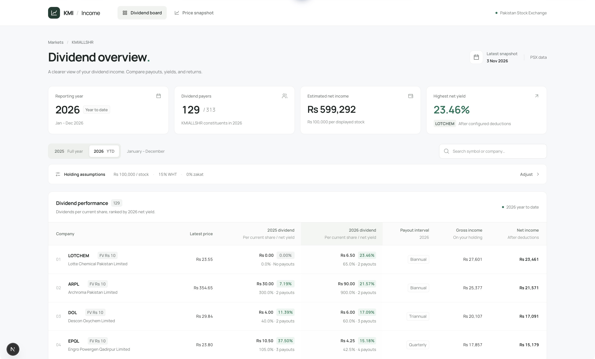

# KMIALLSHR Dividend Board

A Next.js dashboard for exploring cash dividends and current prices for companies
in the Pakistan Stock Exchange (PSX) KMIALLSHR index.

The project stores a committed PSX data snapshot, so the dashboard works without
making requests to PSX at page-load time. Separate importer scripts refresh that
snapshot when required.

## UI preview

The Dividend Board running locally with the 3 November 2026 data snapshot.



## What the app shows

### Dividend Board (`/`)

- Calendar-year dividend totals for 2025 and 2026 (January–December)
- Dividend paid per share, payout count, and payout interval for each year
- Estimated gross and net cash return for a configurable cash amount or share count per stock
- Configurable withholding tax and zakat, with official per-company share face values
- Search by company name or symbol; separate multiple searches with commas, such as `FFC, EFERT, MARI`
- Ranking by net dividend yield for the selected financial year

The ranked table shows companies that paid a dividend in the selected year. The
snapshot itself still contains every constituent returned by the KMIALLSHR index
page, including companies with zero payouts.

### Price Snapshot (`/price-hikes`)

- The latest imported price for each constituent
- The source date associated with each price

This route does not calculate price changes. The dataset contains one current
price per stock, so price-performance calculations would require a separate dated
price history.

## Tech stack

- Next.js 16 with the App Router
- React 19 and TypeScript
- Plain CSS
- Cheerio for parsing PSX HTML responses
- Node's built-in test runner for importer tests

## Requirements

- Node.js 20.18.1 or newer
- npm
- Internet access when refreshing PSX data
- `pdftotext` from Poppler for face-value refreshes and historical archive backfills

## Local development

Install the locked dependencies:

```bash
npm ci
```

Start the development server:

```bash
npm run dev
```

Open [http://localhost:3000](http://localhost:3000).

## Commands

| Command | Purpose |
| --- | --- |
| `npm run dev` | Start the local Next.js development server |
| `npm run build` | Create an optimized production build |
| `npm start` | Serve a completed production build |
| `npm run lint` | Lint application and importer code |
| `npm run test:data` | Run data-parser unit tests |
| `npm run data:fetch` | Refresh constituents, prices, and payouts from PSX |
| `npm run data:face-values` | Fetch official company par values and recalculate the existing snapshot |
| `npm run data:backfill` | Backfill 2025–2026 payouts from PSX archive PDFs through today |
| `npm run data:refresh` | Refresh live data, then backfill historical announcements |

Run the project checks with:

```bash
npm run test:data
npm run lint
npm run build
```

To check the holding controls in Chromium, install the browser with
`npx playwright install chromium`. With the app running locally, run
`npm run test:ui`. Set `TEST_BASE_URL` to check another deployment. These tests
use the committed snapshot's FFC and EFERT dividend amounts.

## Deploy from main

Production uses the `main` branch of
[`humairshoukat/kmiallshr-dividend`](https://github.com/humairshoukat/kmiallshr-dividend).
The Vercel project is `humair-shoukats-projects/kmiallshr-dividend`, and its
production URL is <https://kmiallshr-dividend.vercel.app>.

Vercel is connected to this repository with `main` as its production branch.
Every push or merge to `main` builds and deploys production automatically.
Feature branches must not be deployed to production with the CLI.

## Data sources and refresh behavior

Dividend amounts and verification use only PSX's own payout tables and
announcement sheets. Company financial reports, annual reports, and other
company files are consulted only when necessary to verify the exact current
share face value, including when those files are hosted on PSX. The current
face-value importer uses PSX's official par-value quotations.

The importer uses official PSX pages and endpoints:

- KMIALLSHR constituents and latest prices:
  `https://dps.psx.com.pk/indices/KMIALLSHR`
- PSX-hosted company profile: `https://dps.psx.com.pk/company/<SYMBOL>`
- PSX payout feed: `https://dps.psx.com.pk/company/payouts`
  (POST with the company page's `window.__ps._k` value in `X-Req-Id` and
  `X-Requested-With: XMLHttpRequest`; requests without the ID return 404)
- Historical announcement sheets:
  `https://dps.psx.com.pk/download/announce/<YYYY-MM-DD>.pdf`
- Daily quotations, including the **Par Value Rs.** column for main-board,
  GEM, and non-compliant equities:
  `https://dps.psx.com.pk/download/quote/<YYYY-MM-DD>.pdf`

`data/stocks.json` is the generated, committed snapshot consumed by the app.
`npm run data:fetch` performs the following work:

1. Downloads the current KMIALLSHR constituent list and latest prices.
2. Downloads the most recent published PSX quotation PDF (looking back at most
   14 days for weekends and holidays) and verifies that every constituent has a
   readable par value. Missing values stop the import without changing the snapshot.
3. Fetches each constituent's PSX profile and PSX payout rows. It does not open
   company reports or attachments for dividends.
4. Keeps only announcements dated in calendar years 2025 and 2026 through today.
5. Merges previously observed payouts from the existing snapshot, preserving
   records that may have rolled out of PSX's finite live feed.
6. Reconciles archive copies and correction sheets with live payout events.
7. Recalculates every dividend using that company's current official face value,
   including previously saved and archived payouts.
8. Writes the new snapshot atomically only after every constituent succeeds.

Each stock stores its face value, the quotation's actual publication date, source
URL, PDF page, and dividend calculation basis. The face-value badge on both
dashboards links directly to that source page. `npm run data:face-values` updates
this metadata and dividend totals without re-fetching prices or payout feeds;
their existing `sourceAsOf` date remains unchanged.

The archive backfill checks January 1, 2025 through today (capped at December 31, 2026).
It downloads daily PSX PDFs into the ignored `tmp/` directory, extracts their
text with `pdftotext`, and merges matching dividend announcements into the
current snapshot without duplicating live-feed records. Missing, placeholder,
or unreadable sheets cannot contribute records. Run `npm run data:refresh` for
both the live refresh and historical backfill.

Archive publication dates can differ from company-feed posting dates. The shared
reconciler matches dividend kind and normalized book-closure dates, or equal
amounts with the same period within 31 days. When a period is missing, the fallback
window is seven days. Final and interim dividends remain separate, even with the
same closure dates. Broader matching applies only to comparisons involving an
archive record. Ambiguous matches stop the import. Live payout rows take precedence
over archive copies; among archive copies, later corrections take precedence.
September dates accept both `Sep` and `Sept`.

Four verified PSX field conflicts are documented with source links in
`data/psx-payout-aliases.json`. These identify duplicate events without guessing
across unrelated financial periods. The November 2026 accuracy review and repair
are recorded in [the dividend audit](docs/dividend-audit-2026-11-14.md).

## Financial-year and return methodology

- Reporting years use one shared January–December cycle based on announcement
  dates in Pakistan time. An announcement dated January 1 through December 31,
  2025 belongs to 2025, regardless of the company's own financial year end or
  the accounting period covered by that dividend. Only 2025 and 2026 are retained.
- PSX cash-dividend percentages are converted using each company's current
  official par value: `dividend percent / 100 × company face value`. Values are
  not limited to Rs 1, 2, 5, or 10; decimal par values are also supported.
- Dividend amounts are **per current share**, to match the share basis of the
  latest market price. For example, 450% declared before a 5-for-1 split is
  Rs 45 per old Rs 10 share, equivalent to Rs 9 per current Rs 2 share. The
  importer stores Rs 9 for that comparison. It does not claim this was the
  original cash payment per old share or reconstruct a historical holding.
- This normalization addresses nominal share subdivisions. Bonus shares,
  rights, capital reductions, mergers, and changing historical holdings are not
  reconstructed as a total-return history.
- In **Adjust**, choose **Cash per stock** or **Shares per stock**. Cash mode
  estimates shares as `investment / latest price`, including fractional shares.
  Shares mode applies the entered count, initially 1,000, to every displayed
  stock. Switching modes preserves each input for the current page session.
- Gross income is `shares held × dividend per current share`. The income total
  includes only the displayed stocks. Percentage yields use the latest market
  price in both modes.
- Net cash is gross dividend cash after the combined withholding-tax and zakat
  percentages entered in the dashboard.

The current financial year is year-to-date as of the snapshot date. Calculations
are estimates for exploration, not tax or investment advice.

## Project structure

```text
data/stocks.json                 Generated PSX snapshot
scripts/fetch-psx-data.mjs       Live PSX importer
scripts/fetch-psx-face-values.mjs Official quotation parser and face-value refresh
scripts/psx-http.mjs             Shared paced PSX requests and retries
scripts/backfill-psx-archive.mjs Historical PDF backfill
scripts/fetch-psx-data.test.mjs  Importer unit tests
src/app/                         Next.js routes, layout, and global styles
src/components/                  Dashboard and navigation components
src/lib/stocks.ts                Snapshot types and application data loader
```
